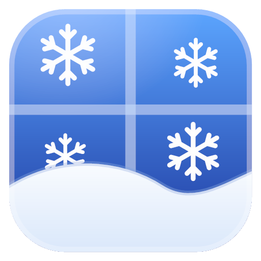

  

<h1 align="center">WinterSill ❄️</h1>

  Cozy snowfall on your Windows desktop.

  

## 🌨️ What it can do

Snow falls over your screen and piles up on your windows, the taskbar and the bottom of the screen. Drag a window and the snow rides along; move it fast and the snow slides off. Close or shrink a window and its snow drops down onto whatever is below. Clicks pass straight through, so you can keep working.

The snow hides during full-screen games and videos, works on all your monitors, and can go lighter or pause on battery power.

## 🎄 New Year

- A wooden sign in the snowdrift on the taskbar counts the days until New Year. On the last day it shows hours and minutes, and the final ten seconds count down in the middle of the screen.
- At midnight on January 1 the snow gathers into the new year's number, turns golden, and fireworks light up the sky.

You can move the countdown under the garland, show both, or turn it off in **Settings → New Year**.

## 🌙 Atmosphere

Add a garland of lights along the top of the screen, frost in the corners or a soft night mode. Let the weather change by itself, or pick a preset: Standard, Quiet evening, Blizzard, Minimal or Festive.

## ⛄ How to play with snow

- Move the cursor fast through a snowdrift to sweep it away, or slowly to leave a trail.
- Hold **Ctrl** and roll through the snow to make a snowball. Let go and it drops right where it is. Stack three to build a snowman.
- Hold **Ctrl** over a snowman's top ball to lift it off, or swipe the mouse sharply through a snowman to knock it down.
- Flick the mouse while releasing **Ctrl** to throw a snowball.

## ⌨️ Keys and controls

| Key or action | What it does |
|---|---|
| Click the tray icon | Quick panel: garland, night mode, countdown, snow amount |
| Double-click the tray icon | Shake all the snow loose |
| Right-click the tray icon | Menu: settings, snow amount, pause, clear |
| **Ctrl+Alt+F9** | Pause or resume the snow |
| **Ctrl+Alt+F10** | Clear all the snow |
| Hold **Ctrl** and move the mouse through snow | Roll a snowball |
| Hold **Ctrl** over a snowman's top ball | Lift the ball off |
| Swipe sharply through a snowman | Knock it down |
| Release **Ctrl** while flicking the mouse | Throw a snowball |

You can change the hotkeys in **Settings → General**, and the snowball key (Ctrl, Shift or Alt) in **Settings → Play**.

## 📥 Download

Prefer not to use the Store? Download the installer from [Releases](https://github.com/4Kcr/WinterSill/releases/latest). Windows may show a SmartScreen warning the first time — click **More info**, then **Run anyway**.

## 📄 License

Free to use, not open source. See [LICENSE](LICENSE).

Created by [4Kcr](https://github.com/4Kcr), with coding help from Claude.
